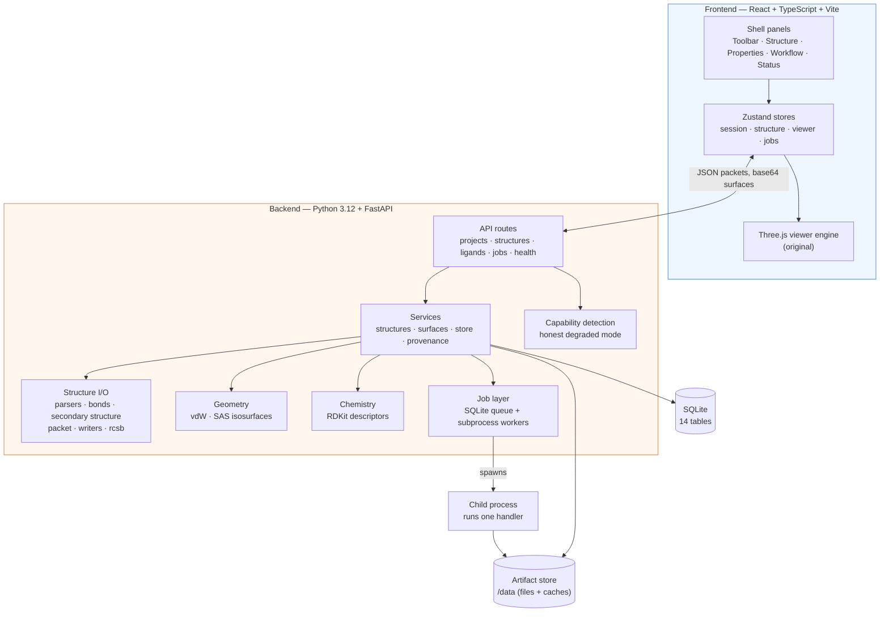

# Architecture

MolDock Studio is a desktop-first, client–server application. The browser (or
the packaged Tauri/Electron shell) runs the **viewer**; a local Python service
does everything that needs chemistry, geometry or files. There is no cloud
dependency: the default deployment is a single machine with a SQLite database
and an on-disk artifact store.

## System overview



## Backend layer map

| Layer | Modules | Responsibility |
| ----- | ------- | -------------- |
| API | `app/api/routes/*`, `app/api/deps.py` | HTTP contract, validation, error envelope, dependency wiring |
| Schemas | `app/schemas/*` | Pydantic request/response models (camelCase on the wire) |
| Services | `app/services/{structures,surfaces,store,provenance}.py` | Use-case orchestration; the only layer that touches the DB and the filesystem together |
| I/O | `app/services/io/*` | Format parsing, bond perception, secondary structure, viewer packets, writers, RCSB fetch |
| Geometry | `app/services/geometry/surface.py` | vdW and solvent-accessible isosurfaces |
| Chemistry | `app/services/chemistry/*` | Element data and RDKit descriptors |
| Jobs | `app/services/jobs/*` | Durable queue, subprocess workers, progress, cancellation, timeouts |
| Core | `app/core/*` | Config, errors, logging, security, capabilities, roadmap |
| DB | `app/db/*` | SQLAlchemy models, session, metadata |

The dependency direction is strictly inward: routes depend on services, services
on I/O/geometry/chemistry, and everything on `core`. No I/O module imports the
API layer.

## The canonical structure object

Every import — regardless of format — becomes one
`app.services.io.types.ParsedStructure`:

- `atoms`: element, coordinates, occupancy, B-factor, altloc, formal charge,
  radius, chain/residue indices.
- `residues`: name, sequence number, insertion code, chain, backbone atom
  indices, and flags (`is_amino_acid`, `is_nucleic`, `is_water`, `is_hetero`).
- `chains`: polymer / ligand / water / ion / other.
- `bonds`: index pairs with a `source` of `"file"` or `"geometry"`.
- `warnings`: structured records of everything dropped or converted.

This single representation is what makes the API format-agnostic and the viewer
simple.

### Bond perception (`io/bonds.py`)

Formats that carry a complete bond block (**SDF/MOL/MOL2**) are trusted
verbatim (`connectivity_source = "file"`); geometry perception is skipped.
**PDB, mmCIF, PDBQT and XYZ** have no reliable bond block, so bonds are
perceived from geometry, polymer-aware:

- intra-residue: by covalent-radius distance;
- inter-residue: only chemically meaningful links —
  disulfide `SG–SG` (true geometry ≤ 2.5 Å), peptide `C(i)–N(i+1)`,
  nucleic `P–O3'`, and covalent polymer↔ligand modifications;
- metals, waters and H–H contacts are never bonded;
- maximum valence keeps the shortest contacts.

The tolerance is ×1.25 of the summed covalent radii with **no** extra slack, so
real bonds (C–C 1.54, C–S 1.81, S–S 2.05, P–O 1.60) are caught while 2.19 Å
non-bonds are not. `validate_bond_lengths` flags implausible lengths **only for
`source == "geometry"`** bonds — a file's own bond block is authoritative.

### Secondary structure (`io/secondary_structure.py`)

File `HELIX`/`SHEET` records are applied first (first-record-wins, insertion
codes respected). Only residues left as coil are then assigned by a
**geometric Cα heuristic** (documented as *not* DSSP): a helix from the
Cα(i)–Cα(i+3)/Cα(i+4) distance test, a strand from Cα–Cα pairing between
residues three apart. `metadata["secondary_structure_method"]` records which
path was used (`"file-records"` or `"geometric-ca-heuristic"`).

## Viewer transport: structure packets

`io/packet.py` serialises a `ParsedStructure` into a **structure packet**:
parallel typed arrays (column-oriented) for atoms and bonds, contiguous residue
and chain slices, colour/radius tables and warnings. `PACKET_VERSION` is part of
the payload so the client can detect a mismatch. The packet is the stable
interface between backend and engine; the frontend never parses chemistry.

## Molecular surfaces (`geometry/surface.py`)

Two scientifically distinct envelopes are computed on the server, cached on
disk, and streamed as base64 float32/uint32 arrays:

- **van der Waals** — the exact union of atomic vdW spheres, via an exact
  nearest-surface signed distance field (`min_i(|x−c_i| − r_i)`) and marching
  cubes. No grid-merging approximation.
- **Solvent-accessible (SAS)** — the Richards probe surface: the vdW field
  inflated by the probe radius.

Grid spacing is chosen from a memory budget (`MAX_GRID_POINTS`); when a structure
is too large the spacing is **coarsened and a warning is recorded** rather than
silently truncating. The **Connolly solvent-excluded surface is not implemented**
and is listed as pending.

## Jobs

Heavy work (surface generation; later, docking and screening) runs out of process:

1. A row is queued in the `jobs` table.
2. The dispatcher (in-process, polling ~0.4 s) spawns a child
   (`spawn` start method) that imports a handler by its `"module:function"`
   string.
3. The child streams progress as JSONL and writes `job.log` and `result.json`
   under the store.
4. Cancellation sends SIGTERM then SIGKILL after 5 s; timeouts end the job with
   `job_timeout`.

Handlers are referenced by string so they survive process spawn. The
`DockingEngine` *interface* is defined now, but no engine is implemented until
Phase 3 — the API has **no docking routes** and `/api/health` marks docking
`not_implemented`.

## Honest capability reporting

`/api/health` probes each scientific tool (RDKit, gemmi, SciPy, scikit-image,
Biopython, AutoDock Vina, Meeko, Open Babel, PDB2PQR) and returns a record per
tool: `available`, `unavailable` or `not_implemented`, with a `remediation`
string when something is missing. The frontend disables the dependent workflow
and shows the remediation instead of failing at click time. Missing optional
fields are omitted (`response_model_exclude_none`), so `remediation` appears
only when there is something to fix.

## Error model

All API errors share one envelope:

```json
{ "error": { "code": "validation_failure", "message": "…", "detail": {…}, "remediation": "…" } }
```

Codes: `not_found`, `conflict`, `validation_failure`, `unsupported_format`,
`structure_parse_error`, `job_timeout`, `upload_rejected`.

## Security posture

- Uploads are size-checked, filename-sanitised, format-sniffed (content first,
  extension second) and written only beneath a resolved project directory.
- No user input is ever passed to a shell; external scientific tools are
  invoked as argument vectors.
- Jobs are isolated child processes with wall-clock timeouts.
- Dependencies are pinned in `uv.lock`.

## Deployment topologies

| Mode | DB | Docking | Notes |
| ---- | -- | ------- | ----- |
| Native (this machine) | SQLite | external Vina binary if provided | `uv sync`; fastest dev loop |
| Docker `linux/arm64` | SQLite in a volume | no | Apple-Silicon-friendly |
| Docker `linux/amd64` | SQLite in a volume | **yes** | full scientific stack |

`MOLDOCK_SCIENTIFIC_BACKEND_MODE` (`native` \| `docker`) is informational and
surfaced through `/api/health`; it does not change behaviour.
